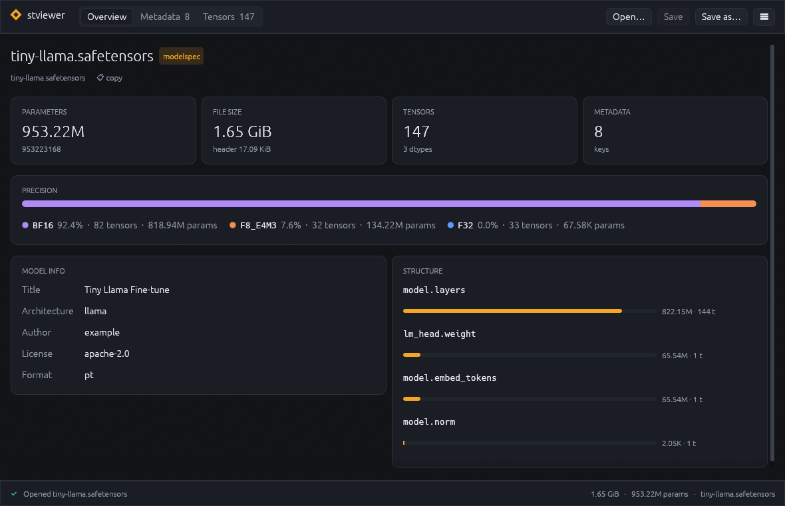
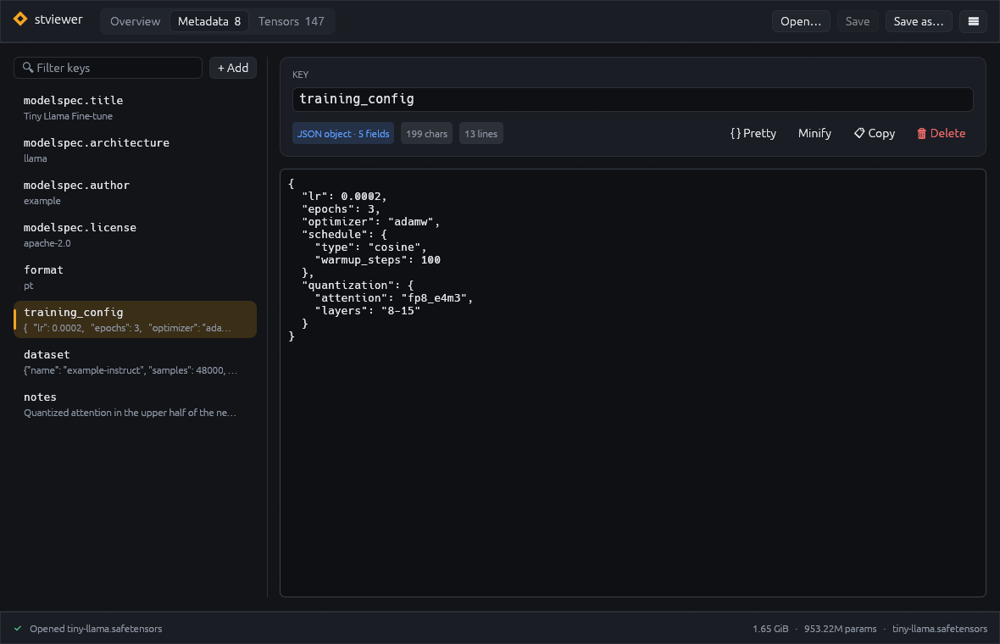
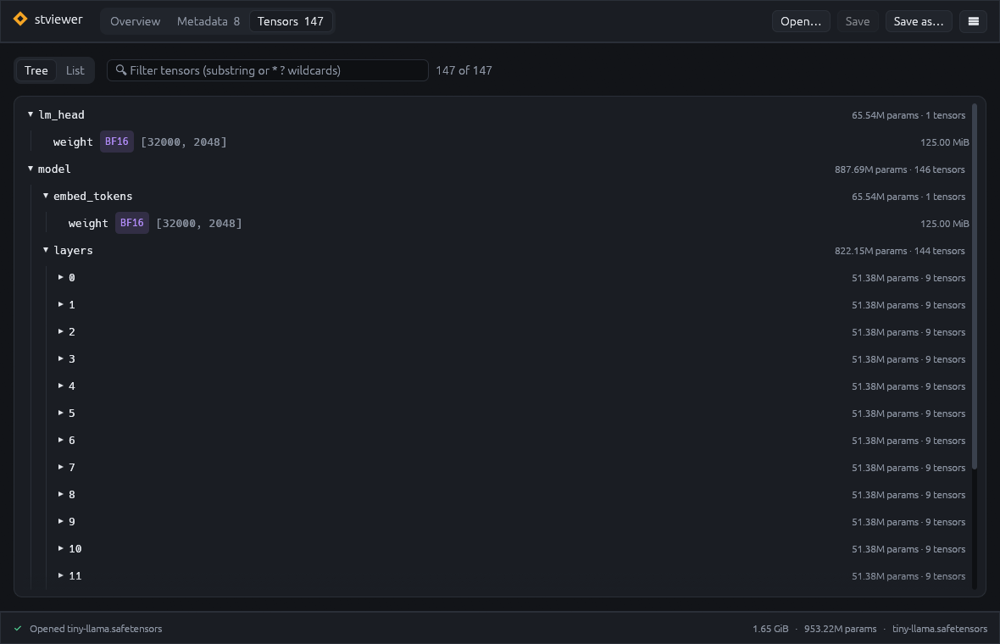
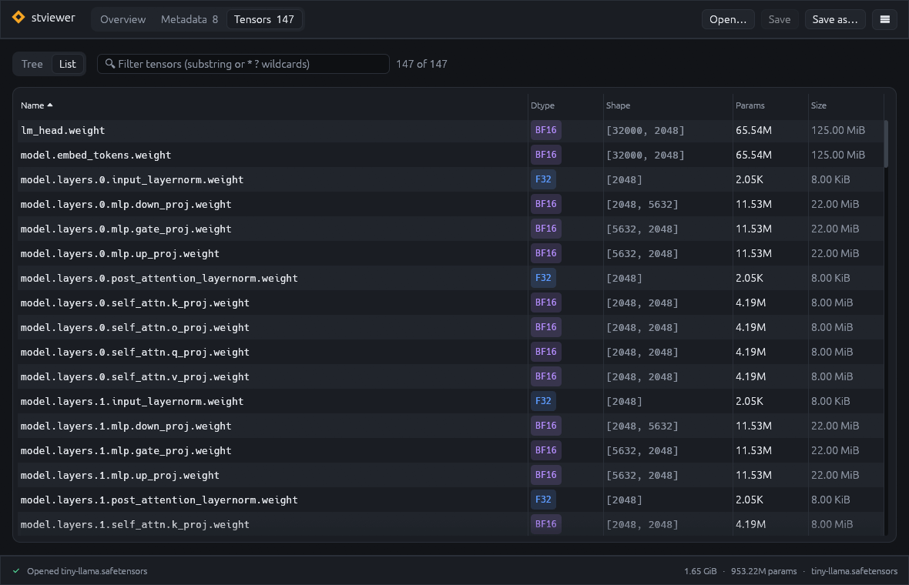
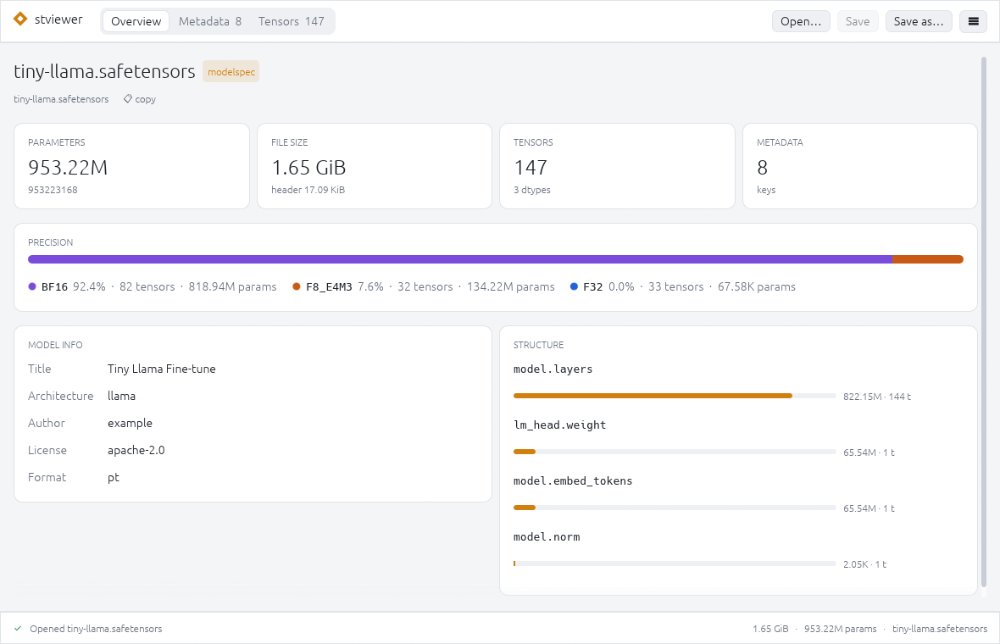

# stviewer

A safe viewer and metadata editor for `.safetensors` files, with a desktop GUI
(`stviewer`) and a scriptable CLI (`stv`).

It only reads the file's JSON header. Tensor data is never parsed or executed;
when metadata is edited, tensor bytes are streamed verbatim into a new file that
is atomically swapped into place.



<table>
  <tr>
    <td width="50%"></td>
    <td width="50%"></td>
  </tr>
  <tr>
    <td align="center"><sub>Edit metadata: add, rename, delete keys; pretty-print JSON values</sub></td>
    <td align="center"><sub>Browse tensors as a tree, grouped by layer</sub></td>
  </tr>
  <tr>
    <td width="50%"></td>
    <td width="50%"></td>
  </tr>
  <tr>
    <td align="center"><sub>…or as a sortable, filterable list</sub></td>
    <td align="center"><sub>Follows your system's light/dark theme</sub></td>
  </tr>
</table>

## Install

Download the latest build for Linux or Windows from the
[Releases page](../../releases/latest). Each archive contains both `stviewer`
(the GUI) and `stv` (the CLI), plus a `.sha256` checksum.

## CLI

```sh
stv show model.safetensors                 # summary (multiple files ok, --json)
stv meta model.safetensors                 # all metadata
stv meta model.safetensors ss_network_dim  # one raw value (exit 1 if missing)
stv meta model.safetensors --json | jq .
stv tensors model.safetensors -f '*lora_up*' [--json]

stv set   model.safetensors author=me license=mit [--backup] [-o out.safetensors]
stv rm    model.safetensors ss_tag_frequency
stv clean *.safetensors --keep modelspec.title   # strip metadata in bulk
stv meta a.safetensors --json | stv import b.safetensors - --merge

# every write command accepts -n/--dry-run to preview the diff
```

## Linux file association

To open `.safetensors` files in stviewer by double-clicking, run this from the
extracted release archive (from a source checkout, use `target/release/stviewer`
and `target/release/stv`):

```sh
install -Dm755 stviewer stv -t ~/.local/bin
install -Dm644 packaging/linux/stviewer.desktop ~/.local/share/applications/stviewer.desktop
install -Dm644 packaging/linux/stviewer.svg ~/.local/share/icons/hicolor/scalable/apps/stviewer.svg
xdg-mime install --novendor packaging/linux/stviewer-mime.xml
xdg-mime default stviewer.desktop application/x-safetensors
```

## Development

| crate         | binary     | purpose                                        |
|---------------|------------|------------------------------------------------|
| `crates/core` | —          | header parsing, validation, atomic rewriting   |
| `crates/cli`  | `stv`      | command line, `--json` output for scripting    |
| `crates/gui`  | `stviewer` | egui desktop app                               |

```sh
cargo build --release        # target/release/{stv,stviewer}
cargo test                   # includes hostile-file and fuzz tests
```

Linux builds need no extra system libraries at runtime beyond a GL driver;
Windows builds are a single `.exe` each.

Releases are built by GitHub Actions: bump `version` in `Cargo.toml`, then
`git tag vX.Y.Z && git push origin vX.Y.Z`.

## License

[MIT](LICENSE)
